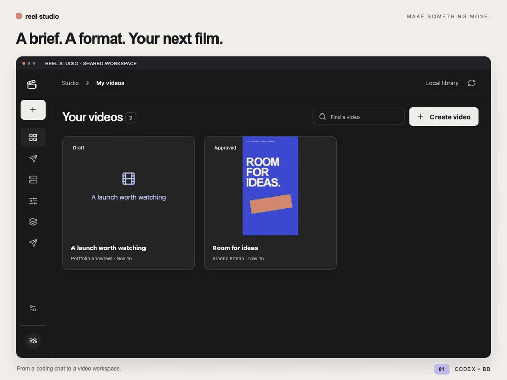

# Reel Studio

[English](README.md) · [Русский](README.ru.md) · [Español](README.es.md) · **Deutsch** · [简体中文](README.zh-CN.md)

**Von der Idee zur geprüften Kurzvideo-Version — direkt in Codex oder BB.**

Reel Studio ist ein Open-Source-Arbeitsbereich von Alex Yarosh. Ideen, Medien, bearbeitbare Animationsvorlagen und Videoversionen bleiben an einem Ort. Freigaben beziehen sich auf das konkrete Video, den Veröffentlichungstext und das Ziel der Veröffentlichung.

<picture>
  <source media="(prefers-reduced-motion: reduce)" srcset="docs/media/reel-studio-overview.png">
  
</picture>

[Vollständigen Rundgang ansehen](docs/media/reel-studio-demo.mp4) · [Statisches Bild ansehen](docs/media/reel-studio-overview.png)

Aufnahmen aus einer separaten Testbibliothek mit fiktiven Projekten. Die Vorschau läuft einmal ab; persönliche Videos und verbundene Konten werden nicht verwendet. Oberfläche und technische Dokumentation sind auf Englisch.

## Videos gestalten und prüfen

- Mit einem Briefing und eigenen Medien beginnen oder [Kinetic Promo](examples/kinetic-promo/README.md) und [Portfolio Showreel](examples/portfolio-showreel/README.md) anpassen.
- Kompositionen aus HTML, GSAP und Three.js bearbeiten und mit HyperFrames und FFmpeg lokal rendern.
- Videos ansehen, gespeicherte Versionen prüfen und eine bestimmte Fassung freigeben.
- Video und Text exportieren oder einen Veröffentlichungsauftrag für den Browser vorbereiten: für YouTube, TikTok oder Instagram, soweit die installierte Host-Umgebung dies unterstützt.

Der Renderer benötigt kein HeyGen. Bilder können aus eigenen Dateien oder einem separat verfügbaren Host-Werkzeug stammen. Automatische Bilderzeugung und API-Guthaben sind nicht enthalten.

## Eigene Werkzeuge und Konten

Die Produktion nutzt die offizielle Codex CLI oder Claude Code CLI mit Ihrem eigenen Konto und Abonnement auf dem Studio-Rechner. Das Panel läuft in Codex oder BB. Claude Code dient als Ausführungsoption, nicht als Host für das Panel.

Optional lassen sich Azure Speech für die Vertonung vollständiger Skripte, DataForSEO für YouTube-Suchrecherchen und Telegram für das ausdrückliche Senden eines ausgewählten Videos verbinden. Azure und DataForSEO werden separat über Ihre Konten abgerechnet.

YouTube OAuth verbindet und prüft einen Kanal über Ihren eigenen Google-Desktop-OAuth-Client. Der Quellcode enthält Hilfsfunktionen für API-Uploads; ein vollständiger Upload-Ablauf im Panel ist bislang nicht vorhanden. Browser-Veröffentlichungen benötigen eine kompatible Host-Umgebung und eine angemeldete Sitzung. Ob ein Beitrag veröffentlicht wurde, muss auf der Zielplattform geprüft werden.

## Einstieg

Aktuelle Version: **[0.4.1 beta](https://github.com/offflinerpsy/reel-studio/releases/tag/v0.4.1)**. Voraussetzungen sind Node.js 22+, npm, FFmpeg und `ffprobe`; die Beispiele benötigen zusätzlich Python 3. Oberfläche und technische Dokumentation sind auf Englisch.

Weiter geht es mit [Installation (English)](docs/getting-started.md), [Host-Kompatibilität (English)](docs/hosts.md) sowie [Konten und Kosten (English)](docs/provider-setup.md). Für erste Versuche empfiehlt sich eine separate Testbibliothek. Die öffentliche Installation übernimmt Daten und Konfiguration einer bestehenden privaten Produktionsumgebung nicht automatisch.

## Zum Projekt beitragen

Eigene Forks, Fehlerberichte und Pull Requests sind willkommen. Hinweise stehen in [CONTRIBUTING (English)](CONTRIBUTING.md) und im [Testleitfaden (English)](docs/testing.md). Der vom Autor verfasste Code steht unter der [MIT-Lizenz](LICENSE); Drittanbieterkomponenten behalten ihre eigenen Bedingungen. Persönliche fertige Videos sind nicht Teil des Repositorys.

Wenn Reel Studio hilfreich ist, freut sich das Projekt über einen [Stern auf GitHub](https://github.com/offflinerpsy/reel-studio).
