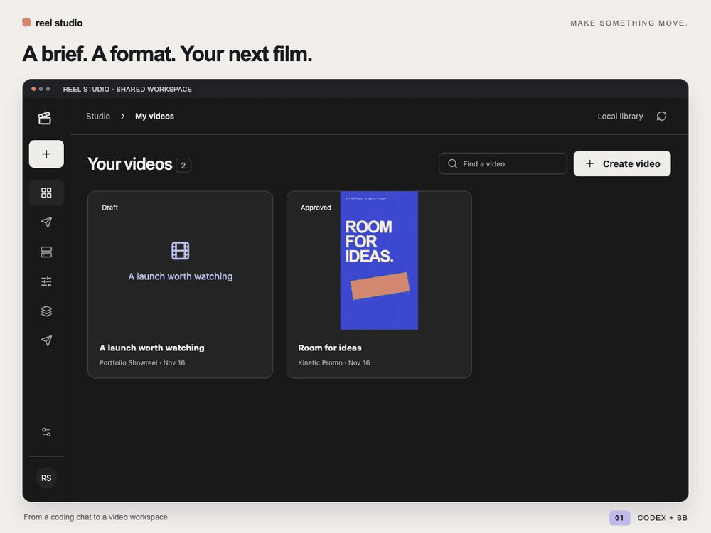

<p align="center">
  <picture>
    <source media="(prefers-color-scheme: dark)" srcset="docs/media/wordmark-dark.svg">
    
  </picture>
</p>

<h3 align="center">A video studio inside your coding chat.</h3>

<p align="center">
  Turn a brief into a short video with editable motion formats.<br>
  Built for <strong>Codex and BB</strong>. Run with your own <strong>Codex or Claude Code</strong> account.
</p>

<p align="center">
  <strong>English</strong> · <a href="README.ru.md">Русский</a> · <a href="README.es.md">Español</a> · <a href="README.de.md">Deutsch</a> · <a href="README.zh-CN.md">简体中文</a>
</p>

<p align="center">
  
</p>

<picture>
  <source media="(prefers-reduced-motion: reduce)" srcset="docs/media/reel-studio-overview.png">
  
</picture>

<p align="center">
  <a href="docs/media/reel-studio-demo.mp4">Watch the walkthrough</a> · <a href="docs/media/reel-studio-overview.png">View the static overview</a>
  <br>
  <sub>A short animated tour, captured from the shared Studio preview with fictional projects. The full walkthrough also shows settings and version review.</sub>
  <br>
  <sub>No personal media or connected provider accounts. The preview plays once; a static alternative is available above.</sub>
</p>

<p align="center">
  <a href="https://github.com/offflinerpsy/reel-studio/releases/tag/v0.4.1"></a>
  &nbsp;
  <a href="#get-started"></a>
  &nbsp;
  <a href="#start-with-a-format"></a>
</p>

## Make the workflow your own

Reel Studio brings the working parts of short-video production into one workspace: briefs, reusable formats, narration, video versions, publication copy and export.

- **Motion you can edit.** Build with HTML, GSAP, Three.js, HyperFrames and FFmpeg. Keep working with code and assets; no HeyGen account is required.
- **Your AI, your tools.** Choose the official Codex or Claude Code CLI on your execution host. Add voice, research and publishing connections when you need them.
- **Review before release.** Preview versions, attach prepared narration and tie approval to the exact film and publication copy.
- **A shared panel for Codex and BB.** Use the same Studio interface through the host integration, with appearance adapted to the host theme.

Creators can start with a format and a brief. Developers can extend the templates, providers and host adapters. There is no bundled AI subscription or generation credit.

## Get started

To explore the interface, install Node.js 22 or later and npm:

```sh
git clone https://github.com/offflinerpsy/reel-studio.git
cd reel-studio
npm run setup
npm run build
npm test
npm run preview
```

The preview opens an isolated library. For production, install FFmpeg with `ffprobe`, authenticate your chosen official CLI, and open **Settings** in the installed panel. Python 3 is needed for the editable examples.

**[Install in Codex or BB](docs/getting-started.md#install-a-host-integration)** · **[Configure your accounts](docs/provider-setup.md)** · **[Check host compatibility](docs/hosts.md)**

## Start with a format

| Starter | What it gives you |
| --- | --- |
| [Kinetic Promo](examples/kinetic-promo/README.md) | Bold typography, rhythmic scenes and dimensional backgrounds. |
| [Portfolio Showreel](examples/portfolio-showreel/README.md) | Layouts, page motion, branding and camera transitions. |
| [Paper Worlds Science](examples/paper-worlds-science/README.md) | A sanitized layered-science design recipe. A creative brief, not a ready-to-render film. |

The bundled examples use fictional content and include dependency notices. The walkthrough's sample projects illustrate the interface; personal finished films are not included.

## Connect only what you need

| Job | Available path |
| --- | --- |
| Run production | Your own Codex or Claude Code CLI account. |
| Build the video | Local or configured-server compute, HyperFrames and FFmpeg. |
| Add narration | Your Azure Speech resource, with explicit synthesis, saved WAV and project attachment. |
| Research publication copy | Optional DataForSEO connection and a bounded request budget. |
| Deliver | Media/copy export, explicit Telegram Bot API delivery, or a supported browser publishing handoff. |

Azure and DataForSEO can incur separate usage charges. Images come from supplied assets or an available authorized host tool. **[Provider capabilities and costs](docs/provider-setup.md)** explains each connection.

<details>
<summary>Current beta scope</summary>

Reel Studio is a public beta. Real account sign-in, paid-provider generation, remote production and host-specific installation depend on your environment.

YouTube OAuth connects and checks a channel; it does not enable a complete API-upload workflow in this panel. Use supported browser handoffs or export. Installing the public core does not automatically migrate an existing private production system.

Source synchronization is explicit and conflict-aware, rather than a background overwrite process. See [configuration](docs/configuration.md), [architecture](docs/architecture.md) and [deliberate updates](docs/getting-started.md#update-deliberately).

</details>

## Build it with us

Found a bug or have a better way to do something? **[Open an issue](https://github.com/offflinerpsy/reel-studio/issues/new/choose)** or **[send a pull request](CONTRIBUTING.md)**.

Forks are welcome. Develop your own version, share a fix, or contribute a new format. Maintainers review what enters this repository; support is best effort. Preserve the applicable license and copyright notices when reusing changes.

**[Contributing](CONTRIBUTING.md)** · **[Testing](docs/testing.md)** · **[Security](SECURITY.md)**

---

Created by **Alex Yarosh**. Owner-authored code is [MIT licensed](LICENSE); third-party components retain their own terms.

If Reel Studio is useful to you, please **[star the repository](https://github.com/offflinerpsy/reel-studio)**.
