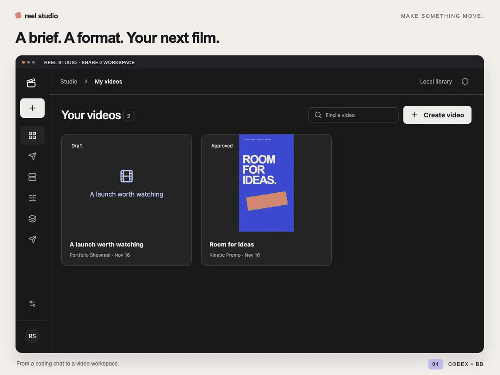

# Reel Studio

[English](README.md) · **Русский** · [Español](README.es.md) · [Deutsch](README.de.md) · [简体中文](README.zh-CN.md)

**От идеи до готовой версии короткого видео — в рабочем пространстве Codex или BB.**

Reel Studio — проект Алекса Яроша с открытым исходным кодом. Здесь можно собирать идеи и материалы, выбирать редактируемые шаблоны анимации, запускать производство и просматривать конкретные версии ролика. Согласования сохраняются вместе с выбранным видео, текстом публикации и площадкой.

<picture>
  <source media="(prefers-reduced-motion: reduce)" srcset="docs/media/reel-studio-overview.png">
  
</picture>

[Полный тур (MP4)](docs/media/reel-studio-demo.mp4) · [Открыть статичный обзор](docs/media/reel-studio-overview.png)

Экраны сняты в отдельной тестовой библиотеке с вымышленными проектами. Превью проигрывается один раз; личные видео и подключённые аккаунты не используются. Интерфейс и техническая документация — на английском.

## Что можно сделать

- Начать с брифа и своих материалов или адаптировать [Kinetic Promo](examples/kinetic-promo/README.md) и [Portfolio Showreel](examples/portfolio-showreel/README.md).
- Менять композиции на HTML, GSAP и Three.js, собирать видео локально с HyperFrames и FFmpeg.
- Просматривать ролики, сравнивать сохранённые версии и согласовывать точный результат перед публикацией.
- Экспортировать видео и текст либо подготовить передачу задачи браузеру для YouTube, TikTok или Instagram при поддержке установленного хоста.

Рендереру не нужен HeyGen. Для изображений можно использовать свои файлы или отдельно доступный инструмент хоста; автоматический генератор изображений и API-кредиты в комплект не входят.

## Свои инструменты и подключения

Производство использует официальный Codex CLI или Claude Code CLI с вашей авторизацией и подпиской на компьютере, где работает Studio. Панель открывается в Codex или BB; Claude Code доступен как исполнитель, а не как отдельный хост интерфейса.

Дополнительно можно подключить Azure Speech для озвучки полного сценария, DataForSEO для исследования поиска YouTube и Telegram для явной отправки выбранного видео. Azure и DataForSEO оплачиваются отдельно в ваших аккаунтах.

YouTube OAuth подключает и проверяет канал через ваш Google Desktop OAuth client. Исходный код содержит вспомогательные функции загрузки через API, но готового сквозного процесса загрузки из панели пока нет. Передача браузеру требует совместимого хоста и действующей сессии. Публикацию нужно проверять на самой площадке.

## Начать работу

Текущая версия — **[0.4.1 beta](https://github.com/offflinerpsy/reel-studio/releases/tag/v0.4.1)**. Нужны Node.js 22+, npm, FFmpeg и `ffprobe`; примерам также нужен Python 3. Интерфейс и техническая документация остаются на английском.

Читайте [установку (English)](docs/getting-started.md), [совместимость хостов (English)](docs/hosts.md) и [подключения и стоимость (English)](docs/provider-setup.md). Начните с отдельной тестовой библиотеки. Установка публичной версии не переносит данные и настройки существующей приватной системы автоматически.

## Развивать вместе

Можно сделать форк для своих задач, сообщить об ошибке или предложить pull request. [Правила участия (English)](CONTRIBUTING.md) и [проверки (English)](docs/testing.md) помогут подготовить изменения. Авторский код распространяется по [MIT License](LICENSE); у сторонних компонентов свои условия. Личные готовые видео в репозиторий не включены.

Если Reel Studio пригодился, можно поддержать проект [звездой на GitHub](https://github.com/offflinerpsy/reel-studio).
