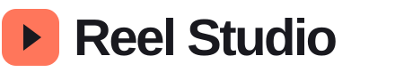

<p align="center">
  <picture>
    <source media="(prefers-color-scheme: dark)" srcset="docs/media/wordmark-dark.svg">
    
  </picture>
</p>

<h3 align="center">Короткие видео из кода — в вашем рабочем чате.</h3>

<p align="center">
  Опишите ролик. Измените исходники. Получите MP4.<br>
  Панель для <strong>Codex и BB</strong>. Исполнитель — ваш <strong>Codex или Claude Code CLI</strong>.
</p>

<p align="center">
  <a href="README.md">English</a> · <strong>Русский</strong>
</p>

<p align="center">
  <a href="https://github.com/offflinerpsy/reel-studio/releases/tag/v0.4.1">Скачать 0.4.1 beta</a> · <a href="#начать-работу">Начать работу</a> · <a href="#готовые-форматы">Форматы</a>
</p>

## Как получается видео

Reel Studio — рабочее пространство с открытым исходным кодом для производства видео. Ролик — редактируемая HTML-композиция: расположение элементов, типографика, движение, тайминг и ссылки на медиа хранятся в исходниках.

1. **Напишите бриф.** Выберите формат, приложите изображения, съёмку или аудио, которые имеете право использовать.
2. **Ваш официальный CLI меняет исходники.** Codex или Claude Code создаёт HTML-композицию, анимацию и вспомогательные файлы, используя GSAP и при необходимости Three.js.
3. **HyperFrames рендерит, FFmpeg готовит MP4.** HyperFrames превращает HTML-анимацию в видео; FFmpeg проверяет закодированное видео и объединяет его с подготовленным аудио. Сборка идёт на вашем компьютере или настроенном сервере.
4. **Проверьте и экспортируйте.** Оцените изображение и звук, сохраните версии, затем экспортируйте ролик с текстом публикации или используйте поддерживаемую передачу в браузер для публикации.

Вручную монтировать таймлайн в графическом видеоредакторе не требуется. Графику можно описать кодом или добавить готовыми файлами. ИИ меняет исходники; рендер использует ваши вычислительные ресурсы, без обязательного платного API генерации видео или аккаунта HeyGen.

## Что потребуется

| Требование | Для чего |
| --- | --- |
| Совместимый **Codex или BB** | Открывает панель Studio. Claude Code — исполнитель, а не хост панели. |
| Ваш **официальный Codex или Claude Code CLI**, установленный с вашей авторизацией на компьютере или сервере Studio | Создаёт и редактирует проекты через ваш аккаунт и тариф. |
| **Node.js 22+ и npm** | Запуск Studio и установка зависимостей. |
| **Python 3** | Запускает сборщики встроенных примеров. |
| **FFmpeg и ffprobe**, среда выполнения и зависимости шаблона | Установка HyperFrames, библиотек и шрифтов описана в инструкции примера. |
| Бриф и материалы по замыслу | Свой текст, изображения, съёмка или аудио. Для типографического ролика достаточно кода и шрифтов шаблона. |

Подписки на ИИ и кредиты провайдеров в комплект не входят. Нужны свой тариф CLI, вычислительные ресурсы и выбранные дополнительные сервисы. См. [подключения и стоимость](docs/provider-setup.md) и [совместимость хостов](docs/hosts.md).

## Начать работу

Для знакомства с интерфейсом из исходников достаточно Node.js 22+ и npm:

```sh
git clone https://github.com/offflinerpsy/reel-studio.git
cd reel-studio
npm run setup
npm run build
npm run preview
```

**Это изолированный просмотр интерфейса. Производство и публикация отключены.** Он не рендерит ролики и не проверяет установку в хосте.

Для производства [установите интеграцию в Codex или BB](docs/getting-started.md#install-a-host-integration), откройте **Settings**, войдите в аккаунт выбранного CLI и установите зависимости формата. Начните с отдельной тестовой библиотеки. Интерфейс и техническая документация — на английском.

**[Полная инструкция установки](docs/getting-started.md)** · **[Настройка аккаунтов](docs/provider-setup.md)** · **[Ограничения хостов](docs/hosts.md)**

## Готовые форматы

| Встроенный формат | Редактируемые исходники |
| --- | --- |
| [Kinetic Promo](examples/kinetic-promo/README.md) | Крупная типографика, ритмичные сцены и объёмные фоны. |
| [Portfolio Showreel](examples/portfolio-showreel/README.md) | Макеты, движение страниц, брендинг и переходы камеры. |

Оба формата включают сборщики и вымышленные примеры. Превью в панели — иллюстративные карточки; готовые демонстрационные видео шаблонов не прилагаются. Добавьте свои материалы и соберите свою версию.

[Paper Worlds Science](examples/paper-worlds-science/README.md) — отдельный рецепт оформления, **не исполняемый шаблон**. Зависимости и сторонние лицензии описаны в каждом примере.

## Дополнительные подключения

| Задача | Возможности |
| --- | --- |
| Озвучка | Добавить своё аудио или подключить свой Azure Speech, сгенерировать WAV и прикрепить его к проекту. |
| Исследование для публикации | Подключить DataForSEO с ограниченным бюджетом запросов. |
| Передача результата | Экспортировать видео и текст, явно отправить через своего Telegram-бота или передать задачу публикации поддерживаемому браузерному инструменту. |

Azure и DataForSEO оплачиваются отдельно в ваших аккаунтах. У настроенных инструментов работы с изображениями — свои условия и стоимость. См. [инструкцию подключений](docs/provider-setup.md).

<details>
<summary>Границы текущей беты</summary>

Reel Studio — **0.4.1 public beta**. Установка, авторизация и производство зависят от вашей среды. Локальный рендер и настроенный сервер не означают совместимость со всеми хостами.

YouTube OAuth проверяет канал; полного процесса API-загрузки из панели пока нет. Используйте поддерживаемую передачу в браузер или экспорт.

Установка не переносит данные существующей приватной системы. Сохраняйте библиотеки и настройки. См. [конфигурацию](docs/configuration.md), [архитектуру](docs/architecture.md) и [обновление](docs/getting-started.md#update-deliberately).

</details>

## Развивать вместе

Нашли ошибку или хотите предложить улучшение? [Откройте issue](https://github.com/offflinerpsy/reel-studio/issues/new/choose) или [пришлите pull request](CONTRIBUTING.md).

Можно сделать форк, поделиться исправлением или добавить формат. Изменения проходят рассмотрение; поддержка — по возможности. Сохраняйте применимые лицензии и уведомления об авторстве.

**[Правила участия](CONTRIBUTING.md)** · **[Проверки](docs/testing.md)** · **[Безопасность](SECURITY.md)**

---

Автор — **Алекс Ярош**. Авторский код распространяется по [MIT License](LICENSE); у сторонних компонентов свои условия.

Если Reel Studio пригодился, поддержите проект [звездой на GitHub](https://github.com/offflinerpsy/reel-studio).
