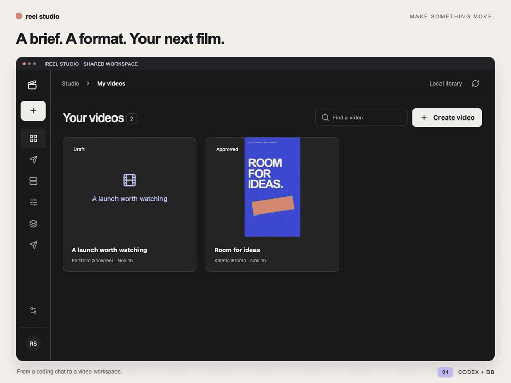

# Reel Studio

[English](README.md) · [Русский](README.ru.md) · [Español](README.es.md) · [Deutsch](README.de.md) · **简体中文**

**在 Codex 或 BB 中，把短视频创意做成可以观看、修改和审核的作品。**

Reel Studio 是 Alex Yarosh 开发的开源短视频工作空间。你可以集中管理创意、素材、可编辑的动画模板和视频版本。每次审核都对应具体的视频文件、发布文案和目标平台，方便确认最终要发布的内容。

<picture>
  <source media="(prefers-reduced-motion: reduce)" srcset="docs/media/reel-studio-overview.png">
  
</picture>

[完整演示（MP4）](docs/media/reel-studio-demo.mp4) · [查看静态图片](docs/media/reel-studio-overview.png)

画面来自独立测试库，使用虚构项目。预览只播放一次，不使用个人视频或已连接的账号。产品界面和技术文档使用英语。

## 从模板到视频

- 写下制作需求，加入自己的素材，或修改 [Kinetic Promo](examples/kinetic-promo/README.md) 和 [Portfolio Showreel](examples/portfolio-showreel/README.md) 示例。
- 编辑 HTML、GSAP 和 Three.js 动画，通过 HyperFrames 和 FFmpeg 在本地渲染。
- 观看成片，检查已保存的版本，再批准具体版本及其发布文案。
- 导出视频和文案，或在兼容的宿主环境中，把 YouTube、TikTok、Instagram 发布任务交给浏览器执行。

渲染不需要 HeyGen。图片可以使用自备素材，也可以使用宿主环境中另外提供的工具。项目不附带自动图片生成服务或 API 额度。

## 使用自己的工具和账号

制作任务在运行 Studio 的电脑上使用官方 Codex CLI 或 Claude Code CLI，需要你自己的账号、订阅和登录状态。Studio 面板运行于 Codex 或 BB；Claude Code 是可选的任务执行工具，不是面板宿主。

可选连接包括：用 Azure Speech 为完整脚本配音，用 DataForSEO 研究 YouTube 搜索，以及明确将选定视频发送到配置好的 Telegram 目标。Azure 和 DataForSEO 的费用由你的账号单独承担。配音生成后应先试听，再作为素材加入项目。

YouTube OAuth 使用你自己的 Google 桌面版 OAuth 客户端连接并核验频道。源码包含 API 上传辅助函数，但面板尚未提供完整的上传流程。通过浏览器发布需要兼容的宿主环境和已登录的账号。连接成功或任务已交接，都不能证明视频已经公开发布；请到目标平台检查结果。

## 开始使用

当前版本为 **[0.4.1 beta](https://github.com/offflinerpsy/reel-studio/releases/tag/v0.4.1)**。需要 Node.js 22+、npm、FFmpeg 和 `ffprobe`，示例还需要 Python 3。产品界面和技术文档使用英语。

请阅读[安装指南（English）](docs/getting-started.md)、[宿主兼容性（English）](docs/hosts.md)及[账号与费用说明（English）](docs/provider-setup.md)。初次体验时请使用独立的测试库。本地预览用于了解界面，不能证明你的环境已经能够生成或发布视频。安装公开版本不会自动迁移现有私有制作系统的数据和配置。

## 按自己的方式参与

你可以 Fork 项目进行修改、提交问题，或通过 Pull Request 提议改进。[贡献指南（English）](CONTRIBUTING.md)和[测试指南（English）](docs/testing.md)说明了提交前的要求。作者编写的代码采用 [MIT License](LICENSE)，第三方组件保留各自的许可条款。仓库不包含个人已完成的视频。

如果 Reel Studio 对你有帮助，欢迎在 GitHub 上[点一颗 Star](https://github.com/offflinerpsy/reel-studio)。
